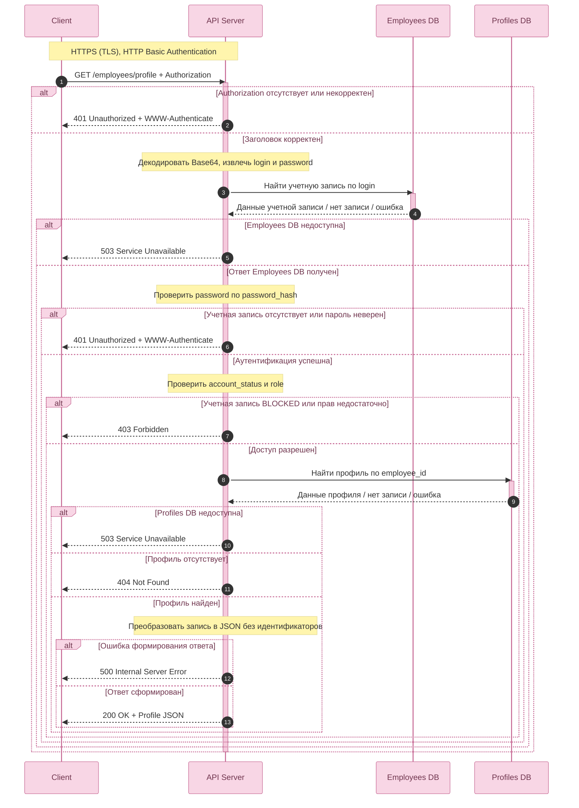

# Корпоративный портал профилей сотрудников

## 1. Назначение и границы решения

**Метод:** `GET /employees/profile`  
**Назначение:** получение сотрудником данных собственного профиля после успешной аутентификации и проверки прав доступа.  
**Транспорт:** HTTPS.  
**Механизм аутентификации:** HTTP Basic Authentication.

Клиент передаёт заголовок `Authorization: Basic <credentials>`, где `<credentials>` — строка `login:password`, закодированная в Base64. Base64 **не является шифрованием**; защита данных при передаче обеспечивается HTTPS (TLS).

Взаимодействуют четыре логических участника:

- **Client** — отправляет запрос и получает HTTP-ответ.
- **API Server** — декодирует заголовок, проверяет пароль и права доступа, формирует HTTP-ответ.
- **Employees DB** — хранит учётные записи, хэши паролей, роли и статусы.
- **Profiles DB** — хранит профили сотрудников.

До успешной аутентификации сервер не обращается к бизнес-логике получения профиля и к Profiles DB. При неуспешной авторизации запрос также не передаётся к Profiles DB.

## 2. Диаграмма последовательности (Mermaid.js)

## 3. Контракт № 1 — Client → API Server

**Операция:** `GET /employees/profile`  
**Назначение:** получить собственный профиль сотрудника.  
**Тело запроса:** отсутствует.  
**Path/query-параметры:** отсутствуют.

### 3.1. Input

| Имя параметра | Тип данных | Обязательность | Описание |
| --- | --- | --- | --- |
| `Authorization` | String | Да | HTTP-заголовок формата `Basic <credentials>`; `<credentials>` — Base64 от `login:password`. |

### 3.2. Output — успешный ответ `200 OK`

| Имя параметра | Тип данных | Обязательность | Nullable | Описание |
| --- | --- | --- | --- | --- |
| `full_name` | String | Да | Да | ФИО сотрудника. |
| `department` | String | Да | Да | Подразделение сотрудника. |
| `position` | String | Да | Да | Должность сотрудника. |

### 3.3. Output — единая структура тела ошибки

| Имя параметра | Тип данных | Обязательность | Описание |
| --- | --- | --- | --- |
| `error_code` | String | Да | Машиночитаемый код ошибки приложения. |
| `message` | String | Да | Безопасное для клиента описание ошибки. |

### 3.4. Возможные HTTP-ответы

| HTTP-статус | `error_code` | Условие / описание |
| --- | --- | --- |
| `200 OK` | — | Профиль найден и успешно возвращён. |
| `401 Unauthorized` | `AUTHENTICATION_FAILED` | Заголовок отсутствует/некорректен; логин не найден или пароль неверен. |
| `403 Forbidden` | `ACCESS_DENIED` | Аутентификация успешна, но учётная запись заблокирована или нет прав на операцию. |
| `404 Not Found` | `PROFILE_NOT_FOUND` | Учётная запись проверена, но связанный профиль не найден. |
| `500 Internal Server Error` | `INTERNAL_ERROR` | Непредвиденная внутренняя ошибка обработки запроса. |
| `503 Service Unavailable` | `SERVICE_UNAVAILABLE` | Требуемая база данных временно недоступна. |

## 4. Контракт № 2 — API Server → Employees DB

**Тип взаимодействия:** внутренний запрос к базе данных (не HTTP API).  
**Цель:** получить сведения учётной записи по логину для проверки пароля и прав.

### 4.1. Input

| Имя параметра | Тип данных | Обязательность | Описание |
| --- | --- | --- | --- |
| `login` | String | Да | Логин, извлечённый API Server из декодированного заголовка `Authorization`. |

### 4.2. Output — найденная учётная запись

| Имя параметра | Тип данных | Описание |
| --- | --- | --- |
| `employee_id` | UUID | Идентификатор сотрудника. |
| `password_hash` | String | Сохранённый хэш пароля для проверки введённого пароля на сервере. |
| `role` | String (ENUM) | Роль учётной записи; используется при проверке прав. |
| `account_status` | ENUM | Статус учётной записи: `ACTIVE` или `BLOCKED`. |

**Альтернативные результаты внутреннего вызова:**

- Учётная запись не найдена — БД возвращает отсутствие строки; API Server формирует `401`.
- Ошибка подключения/недоступность БД — API Server формирует `503`.

## 5. Контракт № 3 — API Server → Profiles DB

**Тип взаимодействия:** внутренний запрос к базе данных (не HTTP API).  
**Цель:** получить профиль аутентифицированного сотрудника после проверки прав.

### 5.1. Input

| Имя параметра | Тип данных | Обязательность | Описание |
| --- | --- | --- | --- |
| `employee_id` | UUID | Да | Идентификатор сотрудника, полученный из Employees DB после успешной проверки доступа. |

### 5.2. Output — найденный профиль

| Имя параметра | Тип данных | Nullable | Описание |
| --- | --- | --- | --- |
| `profile_id` | UUID | Нет | Уникальный идентификатор профиля. |
| `employee_id` | UUID | Нет | Идентификатор владельца профиля. |
| `full_name` | String | Да | ФИО сотрудника. |
| `department` | String | Да | Подразделение сотрудника. |
| `position` | String | Да | Должность сотрудника. |

**Альтернативные результаты внутреннего вызова:**

- Профиль отсутствует (строка не найдена) — API Server формирует `404`.
- База временно недоступна — API Server формирует `503`.

## 6. Маппинг данных

По условию обязательная таблица маппинга требуется **при преобразовании данных перед отправкой во внешнюю систему**. В нашей модели внешнего API нет: Employees DB и Profiles DB являются внутренними хранилищами. Поэтому маппинг внешних интеграций **не требуется**.

Для прозрачности решения ниже приведён **внутренний маппинг** результата Profiles DB в ответ клиенту:

| Поле нашей системы (Profiles DB) | Поле ответа GET | Логика преобразования |
| --- | --- | --- |
| `profile_id` | — | Не включается в клиентский JSON. |
| `employee_id` | — | Используется внутри сервера, не включается в клиентский JSON. |
| `full_name` | `full_name` | Передаётся без изменений, включая допустимый `null`. |
| `department` | `department` | Передаётся без изменений, включая допустимый `null`. |
| `position` | `position` | Передаётся без изменений, включая допустимый `null`. |

## 7. Принятые проектные допущения

1. **Две логически разные базы:** Employees DB хранит данные для контроля доступа, Profiles DB — данные профиля. Они могут быть физически разделены или размещены в одной инфраструктуре; это не меняет последовательность логических вызовов.
2. **Один профиль на сотрудника:** одному `employee_id` соответствует не более одной записи профиля.
3. **Состав профиля:** для учебного примера выбраны `full_name`, `department`, `position`. Задание не задаёт их явно; поля допускают `null`, но присутствуют в успешном JSON-ответе.
4. **Доступ к операции:** роли и правила — предложенная учебная политика, а не прямое требование задания.
5. **Блокировка:** при `account_status = BLOCKED` и верном пароле сервер возвращает `403` в соответствии с выбранной политикой. В иной системе блокировка могла бы приводить к `401`.
6. **Отсутствие профиля:** если аутентифицированный сотрудник существует, но запись профиля отсутствует, возвращается `404`.
7. **HTTPS:** обязателен для передачи HTTP Basic Authentication. В рамках этой схемы TLS заканчивается на API Server; отдельные Gateway/Auth Service и сессии не добавлены.
8. **Проверка пароля:** API Server проверяет пароль по сохранённому хэшу с использованием подходящего алгоритма проверки (например, Argon2id/bcrypt). 

---

**Итог:** сервер допускает обращение к Profiles DB только после проверки Basic Authentication и прав доступа, использует `employee_id` из Employees DB для поиска профиля и возвращает клиенту только необходимые поля собственного профиля.
