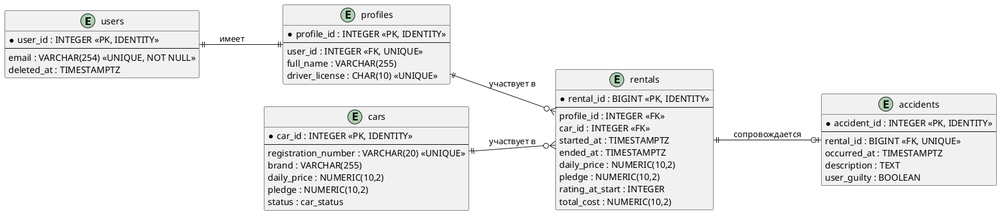

# Physical-level ERD — сервис посуточной аренды автомобилей

**Целевая СУБД:** PostgreSQL  
**Соглашения:** названия таблиц и полей в `snake_case`; таблицы — во множественном числе.  
**Сущности:** `users`, `profiles`, `cars`, `rentals`, `accidents`.

## 1. Таблица `users`

| Поле | Тип PostgreSQL | Ограничения | Назначение |
|---|---|---|---|
| `user_id` | `INTEGER` | `PRIMARY KEY`, `GENERATED ALWAYS AS IDENTITY` | Уникальный идентификатор пользователя. |
| `email` | `VARCHAR(254)` | `UNIQUE`, `NOT NULL` | Адрес электронной почты либо техническое значение после обезличивания. |
| `deleted_at` | `TIMESTAMPTZ` | `NULL` | Дата и время удаления персональных данных; `NULL` — пользователь активен. |

**Soft delete:** при удалении сохраняем `user_id`, заменяем исходный адрес техническим значением `deleted_user_<user_id>@example.invalid`, очищаем персональные данные в связанном профиле и устанавливаем `deleted_at`. Технический домен не должен разрешаться при обычной регистрации. Историю аренд сохраняем.

## 2. Таблица `profiles`

| Поле | Тип PostgreSQL | Ограничения | Назначение |
|---|---|---|---|
| `profile_id` | `INTEGER` | `PRIMARY KEY`, `GENERATED ALWAYS AS IDENTITY` | Идентификатор профиля. |
| `user_id` | `INTEGER` | `FOREIGN KEY → users(user_id)`, `UNIQUE`, `NOT NULL` | Один профиль принадлежит одному пользователю. |
| `full_name` | `VARCHAR(255)` | `NULL` | ФИО; допускается незаполненный профиль до первой аренды. |
| `driver_license` | `CHAR(10)` | `UNIQUE`, `NULL`; `CHECK` на 10 цифр, если значение указано | Номер водительского удостоверения. |

`profiles.user_id UNIQUE` обеспечивает не более одного профиля на пользователя. Бизнес-правило **ровно один профиль на каждого пользователя** обеспечивается одновременным созданием записей `users` и `profiles` в одной транзакции; один внешний ключ не гарантирует существование профиля у любого пользователя.

Перед выдачей автомобиля оба поля `full_name` и `driver_license` должны быть заполнены. При обезличивании пользователя эти значения очищаются, но запись профиля остаётся для сохранения ссылок из `rentals`.

**`rating`** — вычисляемая характеристика, **не физическая колонка** `profiles`. Рейтинг в процентных пунктах: `rating = GREATEST(15, 100 − A)`, где `A` — число ДТП этого пользователя с `user_guilty = TRUE`. На странице профиля значение можно показывать как процент.

## 3. Таблица `cars`

| Поле | Тип PostgreSQL | Ограничения | Назначение |
|---|---|---|---|
| `car_id` | `INTEGER` | `PRIMARY KEY`, `GENERATED ALWAYS AS IDENTITY` | Идентификатор автомобиля. |
| `registration_number` | `VARCHAR(20)` | `UNIQUE`, `NOT NULL` | Государственный номер. |
| `brand` | `VARCHAR(255)` | `NOT NULL` | Марка автомобиля. |
| `daily_price` | `NUMERIC(10,2)` | `NOT NULL`, `CHECK (daily_price > 0)` | Актуальная базовая стоимость суток. |
| `pledge` | `NUMERIC(10,2)` | `NOT NULL`, `CHECK (pledge >= 0)` | Актуальный залог. |
| `status` | `car_status` (`ENUM`) | `NOT NULL` | Текущее состояние автомобиля. |

Значения `car_status`: `AVAILABLE`, `RENTED`, `AFTER_ACCIDENT`, `RETIRED`. Последнее объединяет списанные, проданные и безвозвратно утраченные автомобили. При выбытии меняется статус, а запись сохраняется ради истории аренд. VIN по нашему решению не включаем.

## 4. Таблица `rentals`

| Поле | Тип PostgreSQL | Ограничения | Назначение |
|---|---|---|---|
| `rental_id` | `BIGINT` | `PRIMARY KEY`, `GENERATED ALWAYS AS IDENTITY` | Идентификатор аренды. |
| `profile_id` | `INTEGER` | `FOREIGN KEY → profiles(profile_id)`, `NOT NULL` | Профиль арендатора. |
| `car_id` | `INTEGER` | `FOREIGN KEY → cars(car_id)`, `NOT NULL` | Арендуемый автомобиль; **без обычного `UNIQUE`**, поскольку он участвует в разных арендах. |
| `started_at` | `TIMESTAMPTZ` | `NOT NULL` | Момент выдачи автомобиля. |
| `ended_at` | `TIMESTAMPTZ` | `NULL`; если заполнен, позже `started_at` | Момент фактического завершения. `NULL` — аренда активна. |
| `daily_price` | `NUMERIC(10,2)` | `NOT NULL`, `CHECK (daily_price > 0)` | Базовая суточная ставка, зафиксированная при выдаче, до рейтингового коэффициента. |
| `pledge` | `NUMERIC(10,2)` | `NOT NULL`, `CHECK (pledge >= 0)` | Залог, зафиксированный при выдаче. |
| `rating_at_start` | `INTEGER` | `NOT NULL`, `CHECK (rating_at_start BETWEEN 15 AND 100)` | Рейтинг в процентных пунктах на момент выдачи. |
| `total_cost` | `NUMERIC(10,2)` | `NULL`, `CHECK (total_cost >= 0)` для заполненных значений | Окончательная стоимость; рассчитывается при завершении и сохраняется. |

**Согласованность окончания:** `ended_at` и `total_cost` оба равны `NULL` для активной аренды и оба заполнены для завершённой. Для заполненного `ended_at` действует `ended_at > started_at`.

**Депозит:** отдельного поля нет. Это название минимальной невозвратной платы за первые начавшиеся 24 часа; она равна суточной ставке с применимым рейтинговым расчётом.

**Формулы и обозначения**

- `A` — количество зарегистрированных ДТП пользователя с `user_guilty = TRUE` на момент выдачи.
- `rating_at_start` — рейтинг в процентных пунктах, зафиксированный при выдаче; `R` — рейтинговый коэффициент.
- `DP` — базовая ставка из `rentals.daily_price`; `P` — залог из `rentals.pledge`.
- `x` — число дополнительных **начавшихся** 24-часовых периодов после первых суток.
- `TC` — итоговая сумма `rentals.total_cost`, которая сохраняется при завершении аренды.

Рейтинг при выдаче:

```math
\text{rating\_at\_start}=\max(15,\ 100-5A)
```

```math
R=\frac{\text{rating\_at\_start}}{100}
```

Оплачиваемых суток: `1 + x` (минимум одни сутки; после каждых полных 24 часов следующие начавшиеся сутки оплачиваются целиком).

### Формулы итоговой стоимости

**Обычное завершение, рейтинг выше 15%:** залог возвратный и в `total_cost` не входит.

```math
TC=\frac{DP(1+x)}{R}
```

**ДТП без вины арендатора, рейтинг выше 15%:** применяется та же обычная формула, залог остаётся возвратным.

**ДТП по вине арендатора, рейтинг выше 15%:** стоимость проката рассчитывается по обычной формуле, залог удерживается и однократно включается в `total_cost`.

```math
TC=\frac{DP(1+x)}{R}+P
```

**Любое завершение при рейтинге 15%:** действует десятикратная ставка, залог невозвратный и уже включён в формулу. При виновном ДТП повторно прибавлять залог нельзя.

```math
TC=10DP(1+x)+P
```

Рейтинг и условия определяются **на момент выдачи**. ДТП во время текущей аренды меняет рейтинг только для последующих аренд. При ДТП временем завершения считается `accidents.occurred_at`; итог округляется до двух десятичных знаков и сохраняется. Фактическое движение денег находится за пределами БД.

**Приоритет расчёта:** сначала специальный случай `rating_at_start = 15`; иначе, если ДТП виновное, к обычной стоимости прибавляется залог; в остальных случаях залог не включается.

**Ограничения создания аренды:** не более одной новой аренды пользователя за календарную дату и не более одной активной аренды для каждого профиля и каждого автомобиля. Для активных аренд предусматриваются частичные уникальные индексы по `profile_id` и `car_id` с условием `ended_at IS NULL`. Для правила календарной даты используется часовой пояс `Europe/Moscow`; уникальный индекс строится по `profile_id` и локальной дате `started_at`.

## 5. Таблица `accidents`

| Поле | Тип PostgreSQL | Ограничения | Назначение |
|---|---|---|---|
| `accident_id` | `INTEGER` | `PRIMARY KEY`, `GENERATED ALWAYS AS IDENTITY` | Идентификатор ДТП. |
| `rental_id` | `BIGINT` | `FOREIGN KEY → rentals(rental_id)`, `UNIQUE`, `NOT NULL` | Аренда, в рамках которой произошло ДТП; максимум одно ДТП на аренду. |
| `occurred_at` | `TIMESTAMPTZ` | `NOT NULL` | Дата и время ДТП. |
| `description` | `TEXT` | `NULL` | Необязательное описание ДТП. |
| `user_guilty` | `BOOLEAN` | `NOT NULL` | Установлена ли вина арендатора. |

`car_id` и `profile_id` здесь не дублируются: они определяются через связанную аренду. Не включаем `location` и `damage_level` по согласованному упрощению модели.

Регистрация ДТП завершает аренду и переводит автомобиль в состояние `AFTER_ACCIDENT`. Связанные изменения должны выполняться атомарно. Сведения о зарегистрированном ДТП не редактируются. Расчёт выполняет SQL-функция `calculate_rental_total(...)`, вызываемая при завершении аренды. Сам по себе `INSERT` в `accidents` не запускает расчёт или смену статуса: эти операции выполняются в одной транзакции приложением/операционным SQL.

## Связи — нотация Мартина



## Индексы и проверки при реализации

| Объект | Планируемый индекс / ограничение | Зачем |
|---|---|---|
| `cars` | `(brand, daily_price)` | Поиск машин по марке и цене, указанный в исходном задании. |
| `rentals` | `(profile_id, started_at)` | История аренд пользователя. |
| `rentals` | `(car_id)` | Аренды конкретного автомобиля и соединение с ДТП. |
| `accidents` | `UNIQUE (rental_id)` | Не более одного ДТП на аренду; индекс для соединения с `rentals`. |
| `rentals` | `UNIQUE (profile_id) WHERE ended_at IS NULL` | Не более одной активной аренды пользователя. |
| `rentals` | `UNIQUE (car_id) WHERE ended_at IS NULL` | Не более одной активной аренды автомобиля. |
| `rentals` | Уникальность `(profile_id, локальная дата начала)` | Не более одной новой аренды пользователя за календарную дату; часовой пояс нужно явно определить. |

**Примечание:** типы и ограничения выше отражают нашу согласованную физическую модель. Неочевидные межтабличные и временные проверки (заполненность профиля перед выдачей, статус автомобиля, атомарное завершение при ДТП) требуют реализации в транзакциях приложения и/или средствами PostgreSQL. Изменения стоимости и залога автомобиля не изменяют зафиксированные значения ранее созданных аренд.
